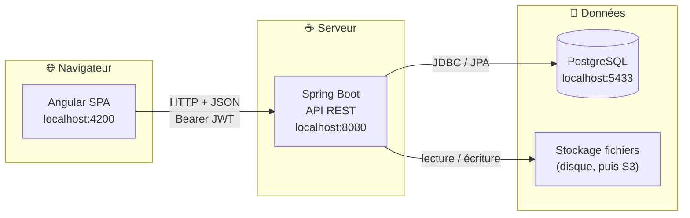
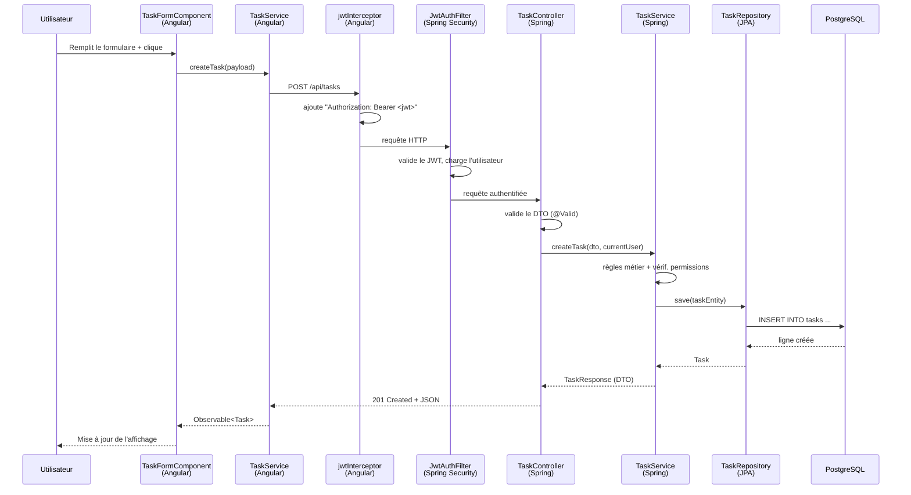
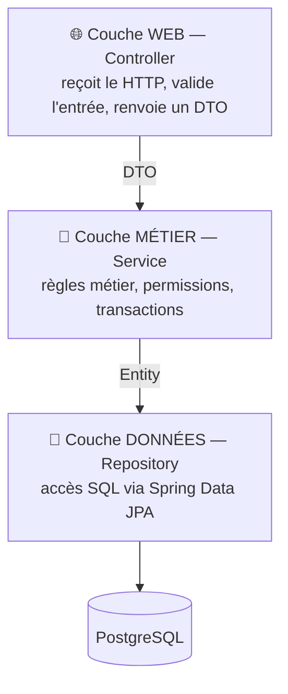
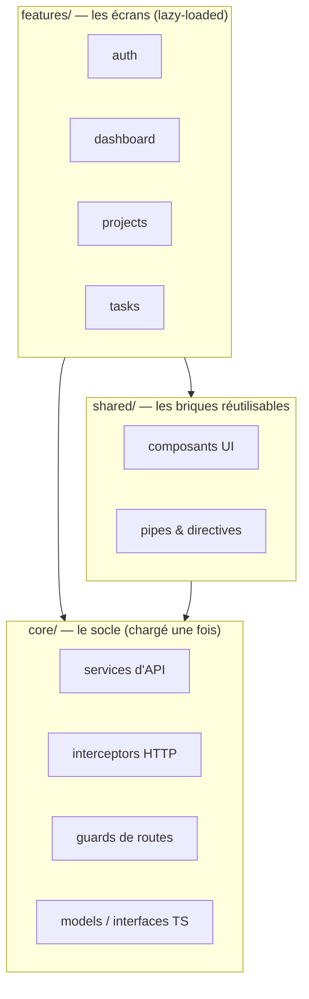
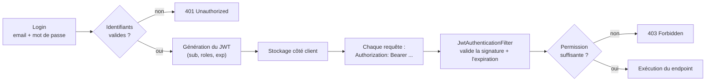

# 01 — Architecture de SmartTask

> **Objectif** : comprendre *comment* l'application est découpée, et *pourquoi*,
> avant d'écrire la première ligne de code.

---

## 1. Vue d'ensemble

SmartTask est une application **client / serveur découplée** :

- un **frontend** Angular, qui est une *SPA* (Single Page Application) — du
  HTML/CSS/JS exécuté dans le navigateur ;
- un **backend** Spring Boot, qui expose une **API REST** en JSON et ne produit
  **aucune page HTML** ;
- une **base de données** PostgreSQL, que seul le backend connaît.



### Pourquoi découpler frontend et backend ?

| Avantage | Explication |
|---|---|
| **Deux métiers séparés** | Tu apprends Angular *et* Spring Boot sans les mélanger |
| **Un seul backend, plusieurs clients** | Demain une app mobile consomme la même API |
| **Déploiement indépendant** | On peut livrer une correction frontend sans toucher au backend |
| **C'est le standard du marché** | Architecture attendue en entretien et en entreprise |

Le prix à payer : il faut gérer le **CORS** (le navigateur bloque par défaut les
appels vers une autre origine) et l'**authentification sans session** (JWT).
On traitera les deux à l'étape 4.

---

## 2. Comment circule une requête (exemple concret)

Scénario : l'utilisateur clique sur « Créer la tâche ».



**Retiens ce schéma** : c'est le même trajet pour *toutes* les fonctionnalités du
projet. Seuls les noms changent.

---

## 3. Architecture du backend (Spring Boot)

### 3.1 Les trois couches

Le backend suit une **architecture en couches**. Chaque couche a une
responsabilité unique et ne parle qu'à sa voisine du dessous.



| Couche | Annotation | Rôle | Ce qu'elle ne fait **jamais** |
|---|---|---|---|
| **Controller** | `@RestController` | Mapper une URL vers une méthode, valider le format d'entrée, choisir le code HTTP | contenir de la logique métier, toucher la base |
| **Service** | `@Service` | Règles métier, vérification des permissions, orchestration, `@Transactional` | connaître HTTP (pas de `HttpServletRequest`) |
| **Repository** | `@Repository` | Requêtes vers la base | contenir des règles métier |

### 3.2 La règle d'or : Entity ≠ DTO

- une **Entity** (`@Entity`) est la représentation d'une table ; elle reste
  **à l'intérieur** du backend ;
- un **DTO** (Data Transfer Object) est ce qui entre et sort par l'API.

Pourquoi ne jamais exposer une Entity directement ?

1. **Sécurité** — une entité `User` contient le hash du mot de passe. L'exposer,
   même par accident, est une faille.
2. **Boucles infinies** — `Task → Project → List<Task> → Project → …` : la
   sérialisation JSON part en récursion.
3. **Couplage** — renommer une colonne casserait le contrat d'API de tous les
   clients.
4. **Validation différenciée** — à la création on exige un mot de passe, à la
   mise à jour non. Deux DTO, une seule entité.

Convention de nommage adoptée dans le projet :

| Suffixe | Sens | Exemple |
|---|---|---|
| `...Request` | Données entrantes | `CreateTaskRequest`, `UpdateTaskRequest` |
| `...Response` | Données sortantes | `TaskResponse`, `UserResponse` |
| `...Summary` | Version allégée pour les listes | `TaskSummary` |

La conversion Entity ↔ DTO est faite par un **Mapper** (`TaskMapper`).

### 3.3 Organisation des packages : *par fonctionnalité*

Deux écoles s'opposent :

```
❌ package-by-layer              ✅ package-by-feature  (notre choix)
   controller/                      task/
     TaskController                   TaskController
     ProjectController                TaskService
     UserController                   TaskRepository
   service/                           Task
     TaskService                      dto/
     ProjectService                 project/
   repository/                        ProjectController
     ...                              ...
```

On choisit **package-by-feature** : tout ce qui concerne les tâches est dans un
seul dossier. Pour une fonctionnalité, tu ouvres un dossier au lieu de naviguer
entre cinq. Ça passe mieux à l'échelle et c'est ce qui se fait sur les projets
récents.

### 3.4 Arborescence complète du backend

```
backend/
├── mvnw , mvnw.cmd , .mvn/           # Maven Wrapper (pas de Maven à installer)
├── pom.xml                           # dépendances + configuration du build
├── Dockerfile                        # image de production        (étape 12)
└── src/
    ├── main/
    │   ├── java/com/smarttask/
    │   │   ├── SmartTaskApplication.java      # point d'entrée (main)
    │   │   │
    │   │   ├── common/                        # ── code transverse ──
    │   │   │   ├── config/
    │   │   │   │   ├── SecurityConfig.java        # règles de sécurité, CORS
    │   │   │   │   ├── OpenApiConfig.java         # métadonnées Swagger
    │   │   │   │   └── JpaConfig.java             # auditing (createdAt/By)
    │   │   │   ├── exception/
    │   │   │   │   ├── GlobalExceptionHandler.java  # @RestControllerAdvice
    │   │   │   │   ├── ApiError.java                # format d'erreur unique
    │   │   │   │   ├── ResourceNotFoundException.java
    │   │   │   │   └── BusinessRuleException.java
    │   │   │   ├── entity/
    │   │   │   │   └── BaseEntity.java         # id, createdAt, updatedAt
    │   │   │   └── dto/
    │   │   │       └── PageResponse.java       # pagination normalisée
    │   │   │
    │   │   ├── security/                      # ── authentification ──
    │   │   │   ├── JwtService.java                # génère / valide les tokens
    │   │   │   ├── JwtAuthenticationFilter.java   # lit l'en-tête Authorization
    │   │   │   ├── CustomUserDetailsService.java
    │   │   │   └── SecurityUtils.java             # "qui est l'utilisateur courant ?"
    │   │   │
    │   │   ├── auth/                          # ── inscription / connexion ──
    │   │   │   ├── AuthController.java            # /api/auth/**
    │   │   │   ├── AuthService.java
    │   │   │   └── dto/  (RegisterRequest, LoginRequest, AuthResponse)
    │   │   │
    │   │   ├── user/                          # ── fonctionnalité : utilisateurs ──
    │   │   │   ├── User.java                      # @Entity
    │   │   │   ├── Role.java                      # enum ADMIN / MANAGER / MEMBER
    │   │   │   ├── UserRepository.java
    │   │   │   ├── UserService.java
    │   │   │   ├── UserController.java
    │   │   │   ├── UserMapper.java
    │   │   │   └── dto/
    │   │   │
    │   │   ├── project/     # Project, ProjectMember, ProjectStatus, repo/service/...
    │   │   ├── task/        # Task, TaskStatus, TaskPriority, repo/service/...
    │   │   ├── comment/     # Comment + CRUD
    │   │   ├── attachment/  # upload / download de fichiers
    │   │   ├── notification/# notifications in-app
    │   │   ├── dashboard/   # agrégations et statistiques (lecture seule)
    │   │   └── ai/          # module IA                          (étape 14)
    │   │
    │   └── resources/
    │       ├── application.yml              # config commune
    │       ├── application-dev.yml          # profil développement
    │       ├── application-prod.yml         # profil production
    │       └── db/migration/                # scripts Flyway
    │           ├── V1__create_users.sql
    │           ├── V2__create_projects.sql
    │           └── ...
    └── test/
        └── java/com/smarttask/
            ├── task/TaskServiceTest.java         # test unitaire (Mockito)
            └── task/TaskControllerIT.java        # test d'intégration
```

### 3.5 Choix structurants du backend

| Sujet | Décision | Justification courte |
|---|---|---|
| Préfixe d'API | `/api/**` | sépare proprement API et ressources statiques |
| Versionnement | pas de `/v1` au début | simplicité ; on documente la stratégie dans l'ADR |
| Authentification | **JWT** *stateless* | pas de session serveur, adapté à une SPA |
| Mots de passe | **BCrypt** | standard, lent par conception = résistant au bruteforce |
| Schéma de BDD | **Flyway** (migrations SQL versionnées) | `ddl-auto: update` est interdit en production |
| Pagination | obligatoire sur toutes les listes | une liste non paginée finit toujours par exploser |
| Erreurs | un `@RestControllerAdvice` unique | le frontend n'a qu'**un seul** format d'erreur à gérer |
| Documentation | **springdoc-openapi** | Swagger UI généré automatiquement depuis le code |

---

## 4. Architecture du frontend (Angular)

### 4.1 Les trois zones



**Règle de dépendance, à ne jamais enfreindre** :
`features → shared → core`. Jamais l'inverse, et **jamais une feature qui
importe une autre feature** (sinon le *lazy loading* ne sert plus à rien et on
crée des dépendances circulaires).

| Dossier | Contient | Durée de vie |
|---|---|---|
| `core/` | Ce qui doit exister en **un seul exemplaire** : services d'API, interceptors, guards, modèles | toute l'application |
| `shared/` | Ce qui est **réutilisé sans logique métier** : bouton, badge de statut, modale, spinner, pipes | à la demande |
| `layout/` | La coquille visuelle : navbar, sidebar, footer | toute l'application |
| `features/` | Un dossier **par domaine fonctionnel**, chargé à la demande | à la navigation |

### 4.2 Arborescence complète du frontend

```
frontend/
├── angular.json , package.json , tsconfig.json
├── Dockerfile , nginx.conf                    # production        (étape 12)
└── src/
    ├── main.ts                                # bootstrap
    ├── styles.scss                            # styles globaux + thème
    ├── environments/
    │   ├── environment.ts                     # apiUrl = localhost:8080/api
    │   └── environment.prod.ts
    └── app/
        ├── app.component.ts                   # racine
        ├── app.config.ts                      # providers (HTTP, router, interceptors)
        ├── app.routes.ts                      # routes racines + lazy loading
        │
        ├── core/
        │   ├── models/
        │   │   ├── user.model.ts              # interfaces = miroir des DTO backend
        │   │   ├── project.model.ts
        │   │   ├── task.model.ts
        │   │   └── page.model.ts              # Page<T>
        │   ├── services/
        │   │   ├── auth.service.ts            # login/logout, état utilisateur (signal)
        │   │   ├── token.service.ts           # lecture/écriture du JWT
        │   │   ├── project.service.ts
        │   │   ├── task.service.ts
        │   │   └── notification.service.ts
        │   ├── interceptors/
        │   │   ├── jwt.interceptor.ts         # ajoute le Bearer token
        │   │   ├── error.interceptor.ts       # 401 → logout, 403/500 → toast
        │   │   └── loading.interceptor.ts     # barre de chargement globale
        │   └── guards/
        │       ├── auth.guard.ts              # route protégée ?
        │       └── role.guard.ts              # rôle suffisant ?
        │
        ├── shared/
        │   ├── components/
        │   │   ├── status-badge/
        │   │   ├── priority-badge/
        │   │   ├── confirm-dialog/
        │   │   ├── empty-state/
        │   │   └── user-avatar/
        │   └── pipes/
        │       └── time-ago.pipe.ts
        │
        ├── layout/
        │   ├── main-layout/                   # <navbar> <sidebar> <router-outlet>
        │   ├── navbar/
        │   └── sidebar/
        │
        └── features/
            ├── auth/          login/ , register/ , auth.routes.ts
            ├── dashboard/     dashboard-page/ , stat-card/ , charts/
            ├── projects/      project-list/ , project-detail/ , project-form/
            ├── tasks/         task-list/ , task-board/ (kanban) , task-detail/ , task-form/
            ├── notifications/
            └── profile/
```

### 4.3 Choix structurants du frontend

| Sujet | Décision | Justification courte |
|---|---|---|
| Composants | **standalone** (sans `NgModule`) | approche moderne et recommandée d'Angular |
| État | **signals** (`signal`, `computed`) | réactivité simple, intégrée, pas de librairie externe |
| Appels HTTP | `HttpClient` + un **service par domaine** | aucun composant n'appelle l'API directement |
| Routing | **lazy loading** par feature | le navigateur ne télécharge que l'écran affiché |
| Templates | nouvelle syntaxe `@if` / `@for` | remplace `*ngIf` / `*ngFor` |
| Formulaires | **Reactive Forms** | validation et typage robustes, testables |
| Styles | SCSS + variables CSS | thématisation simple, pas de dépendance lourde |
| URL de l'API | fichier `environment.ts` | aucune URL codée en dur dans le code |

---

## 5. Sécurité : vue d'ensemble



### Les trois rôles

| Rôle | Peut faire |
|---|---|
| `ADMIN` | tout : gérer les utilisateurs, tous les projets |
| `MANAGER` | créer des projets, ajouter des membres, assigner des tâches |
| `MEMBER` | voir ses projets, créer et modifier les tâches qui lui sont assignées, commenter |

Deux niveaux de contrôle, complémentaires :

1. **Par rôle** (global) — `@PreAuthorize("hasRole('MANAGER')")` sur la méthode.
2. **Par appartenance** (contextuel) — « cet utilisateur est-il membre de *ce*
   projet ? ». Ce contrôle est fait **dans le service**, car lui seul a accès aux
   données.

> ⚠️ **Le contrôle côté Angular n'est pas de la sécurité.** Cacher un bouton
> améliore l'ergonomie, rien de plus : n'importe qui peut appeler l'API
> directement. **La sécurité est toujours côté backend.**

---

## 6. Récapitulatif des conventions

### Nommage

| Élément | Convention | Exemple |
|---|---|---|
| Table SQL | `snake_case`, pluriel | `task_comments` |
| Colonne SQL | `snake_case` | `created_at`, `project_id` |
| Classe Java | `PascalCase` | `TaskService` |
| Champ Java / JSON | `camelCase` | `dueDate` |
| Endpoint REST | `kebab-case`, nom pluriel | `/api/projects/{id}/tasks` |
| Fichier Angular | `kebab-case.type.ts` | `task-list.component.ts` |
| Interface TS | `PascalCase`, sans préfixe `I` | `Task`, `CreateTaskRequest` |
| Branche git | `type/description-courte` | `feat/task-crud` |

### Codes HTTP utilisés

| Code | Quand |
|---|---|
| `200 OK` | lecture ou mise à jour réussie |
| `201 Created` | création réussie (+ en-tête `Location`) |
| `204 No Content` | suppression réussie |
| `400 Bad Request` | données invalides (échec de validation) |
| `401 Unauthorized` | pas de token, token invalide ou expiré |
| `403 Forbidden` | authentifié mais pas autorisé |
| `404 Not Found` | ressource inexistante |
| `409 Conflict` | conflit métier (email déjà pris…) |
| `500 Internal Server Error` | bug côté serveur |

---

## 7. Ce que l'architecture prévoit pour plus tard

Décisions prises **maintenant** pour que les étapes avancées ne demandent pas de
tout réécrire :

| Besoin futur | Ce qu'on prépare dès l'étape 1 |
|---|---|
| Notifications temps réel (WebSocket) | notifications stockées en base dès le départ, pas seulement poussées |
| Stockage fichiers sur S3 | une interface `FileStorageService` avec une implémentation locale ; on en ajoutera une S3 |
| Module IA (étape 14) | un package `ai/` isolé qui consomme les services existants, sans les modifier |
| Montée en charge | backend *stateless* (JWT, aucune session) → réplicable à l'identique |
| Recherche avancée | recherche via **Specifications** JPA (critères combinables) plutôt que 15 méthodes de repository |

---

## 8. Étape suivante

→ [`02-MODELE-DONNEES.md`](02-MODELE-DONNEES.md) : les entités et leurs relations.
→ [`04-ROADMAP.md`](04-ROADMAP.md) : le plan complet des 14 étapes.
