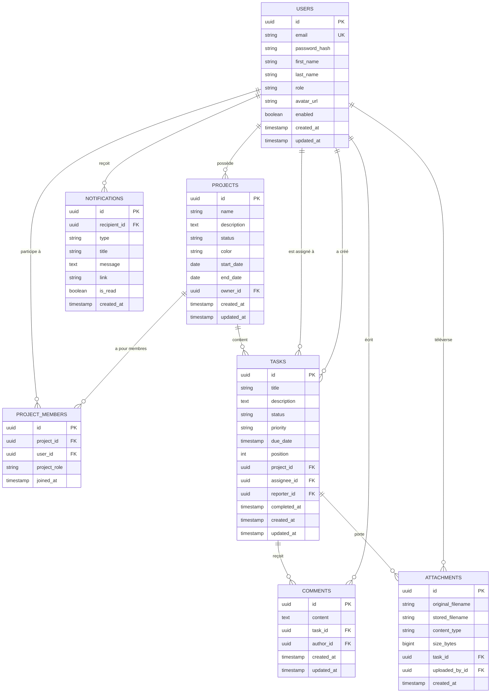

# 02 — Modèle de données

> **Objectif** : définir les entités, leurs champs, leurs relations et les règles
> métier associées. C'est la fondation : une erreur ici coûte cher plus tard.

---

## 1. Diagramme entité-relation



---

## 2. Les entités en détail

### 2.1 `User` — utilisateur

| Champ | Type | Contraintes | Note |
|---|---|---|---|
| `id` | UUID | PK | généré par l'application |
| `email` | String(180) | **unique**, non nul, format email | sert d'identifiant de connexion |
| `passwordHash` | String(100) | non nul | **BCrypt**, jamais exposé par l'API |
| `firstName` | String(60) | non nul | |
| `lastName` | String(60) | non nul | |
| `role` | enum | non nul, défaut `MEMBER` | `ADMIN` / `MANAGER` / `MEMBER` |
| `avatarUrl` | String(255) | nullable | |
| `enabled` | boolean | non nul, défaut `true` | désactivation sans suppression |
| `createdAt` / `updatedAt` | timestamp | automatiques | via JPA Auditing |

**Pourquoi des UUID et pas des `BIGINT auto-increment` ?**

| | UUID | Auto-increment |
|---|---|---|
| Devine-t-on les autres IDs ? | non | **oui** (`/users/1`, `/users/2`…) |
| Génération avant insertion | oui | non |
| Fusion de bases / microservices | facile | collisions |
| Lisibilité en debug | moins bonne | meilleure |

On privilégie la sécurité et la souplesse : **UUID**.

### 2.2 `Project` — projet

| Champ | Type | Contraintes |
|---|---|---|
| `id` | UUID | PK |
| `name` | String(120) | non nul, 3–120 caractères |
| `description` | text | nullable |
| `status` | enum | `PLANNING` / `ACTIVE` / `ON_HOLD` / `COMPLETED` / `ARCHIVED` |
| `color` | String(7) | code hexadécimal, ex. `#4F46E5` — pour l'UI |
| `startDate` / `endDate` | date | nullable ; `endDate >= startDate` |
| `owner` | → `User` | `@ManyToOne`, non nul |

### 2.3 `ProjectMember` — appartenance à un projet

C'est une relation **many-to-many avec attribut** : un utilisateur appartient à
plusieurs projets, un projet a plusieurs membres, **et** on veut stocker son rôle
*dans ce projet précis*.

| Champ | Type | Note |
|---|---|---|
| `id` | UUID | PK |
| `project` | → `Project` | `@ManyToOne` |
| `user` | → `User` | `@ManyToOne` |
| `projectRole` | enum | `OWNER` / `MANAGER` / `CONTRIBUTOR` / `VIEWER` |
| `joinedAt` | timestamp | |

> 🔑 **Point pédagogique important.** Une `@ManyToMany` JPA classique crée une
> table de jointure invisible à laquelle **on ne peut rien ajouter**. Dès qu'il
> faut une colonne supplémentaire (ici `projectRole`), il faut en faire une
> **entité à part entière** avec deux `@ManyToOne`. C'est un cas qu'on rencontre
> dans presque tous les projets réels.

Contrainte : **unicité du couple** `(project_id, user_id)`.

### 2.4 `Task` — tâche

| Champ | Type | Contraintes |
|---|---|---|
| `id` | UUID | PK |
| `title` | String(200) | non nul, 3–200 caractères |
| `description` | text | nullable |
| `status` | enum | `TODO` / `IN_PROGRESS` / `IN_REVIEW` / `DONE` / `CANCELLED` |
| `priority` | enum | `LOW` / `MEDIUM` / `HIGH` / `URGENT` |
| `dueDate` | timestamp | nullable |
| `position` | int | ordre dans la colonne du kanban |
| `project` | → `Project` | `@ManyToOne`, non nul |
| `assignee` | → `User` | `@ManyToOne`, **nullable** (tâche non assignée) |
| `reporter` | → `User` | `@ManyToOne`, non nul — le créateur |
| `completedAt` | timestamp | rempli automatiquement au passage à `DONE` |

> ⚠️ `Task` a **deux** relations vers `User` (`assignee` et `reporter`). Il faudra
> donc nommer explicitement les colonnes (`assignee_id`, `reporter_id`) : Hibernate
> ne peut pas deviner.

### 2.5 `Comment` — commentaire

| Champ | Type | Contraintes |
|---|---|---|
| `id` | UUID | PK |
| `content` | text | non nul, 1–2000 caractères |
| `task` | → `Task` | `@ManyToOne`, non nul |
| `author` | → `User` | `@ManyToOne`, non nul |

Règle : seul l'auteur (ou un `ADMIN`) peut modifier ou supprimer son commentaire.

### 2.6 `Attachment` — fichier joint

| Champ | Type | Note |
|---|---|---|
| `id` | UUID | PK |
| `originalFilename` | String(255) | le nom choisi par l'utilisateur |
| `storedFilename` | String(255) | nom **généré** sur le disque |
| `contentType` | String(100) | ex. `application/pdf` |
| `sizeBytes` | bigint | plafond : 10 Mo |
| `task` | → `Task` | `@ManyToOne` |
| `uploadedBy` | → `User` | `@ManyToOne` |

> 🔒 **Ne jamais réutiliser le nom de fichier fourni par l'utilisateur** sur le
> disque : c'est la porte ouverte à l'écrasement de fichiers et aux attaques par
> *path traversal* (`../../etc/passwd`). On stocke sous un UUID et on garde le nom
> d'origine en base, uniquement pour l'affichage et le téléchargement.

### 2.7 `Notification` — notification

| Champ | Type | Note |
|---|---|---|
| `id` | UUID | PK |
| `recipient` | → `User` | `@ManyToOne` |
| `type` | enum | `TASK_ASSIGNED`, `TASK_STATUS_CHANGED`, `COMMENT_ADDED`, `DUE_DATE_SOON`, `PROJECT_INVITATION` |
| `title` | String(150) | |
| `message` | text | |
| `link` | String(255) | route Angular à ouvrir au clic, ex. `/tasks/{id}` |
| `isRead` | boolean | défaut `false` |

---

## 3. Les énumérations

```
Role            : ADMIN | MANAGER | MEMBER
ProjectStatus   : PLANNING | ACTIVE | ON_HOLD | COMPLETED | ARCHIVED
ProjectRole     : OWNER | MANAGER | CONTRIBUTOR | VIEWER
TaskStatus      : TODO | IN_PROGRESS | IN_REVIEW | DONE | CANCELLED
TaskPriority    : LOW | MEDIUM | HIGH | URGENT
NotificationType: TASK_ASSIGNED | TASK_STATUS_CHANGED | COMMENT_ADDED
                  | DUE_DATE_SOON | PROJECT_INVITATION
```

> 💡 En base, on stockera les enums **sous forme de texte**
> (`@Enumerated(EnumType.STRING)`), jamais en `ORDINAL`. Avec `ORDINAL`, insérer
> une valeur au milieu de l'enum réécrit silencieusement le sens de toutes les
> lignes existantes. C'est un bug classique et très douloureux.

---

## 4. Règles métier

### Utilisateurs
- R1 — l'email est unique dans toute l'application.
- R2 — le mot de passe fait au moins 8 caractères, avec une majuscule, une
  minuscule et un chiffre.
- R3 — un utilisateur `enabled = false` ne peut plus se connecter.

### Projets
- R4 — le créateur devient automatiquement `owner` **et** membre avec le rôle `OWNER`.
- R5 — un projet a toujours au moins un membre `OWNER`.
- R6 — seul l'`owner` ou un `ADMIN` peut supprimer un projet.
- R7 — supprimer un projet supprime ses tâches (cascade), donc aussi leurs
  commentaires et pièces jointes.

### Tâches
- R8 — une tâche appartient obligatoirement à un projet.
- R9 — on ne peut assigner une tâche qu'à un **membre du projet**.
- R10 — passer à `DONE` renseigne `completedAt` ; en sortir le remet à `null`.
- R11 — seuls l'`assignee`, le `reporter`, un `MANAGER` du projet ou un `ADMIN`
  peuvent modifier une tâche.
- R12 — si `dueDate` est fournie, elle doit être dans le futur **à la création**.

### Commentaires et fichiers
- R13 — il faut être membre du projet pour commenter une tâche.
- R14 — seul l'auteur ou un `ADMIN` peut modifier/supprimer un commentaire.
- R15 — fichiers : 10 Mo maximum, types autorisés = images, PDF, documents
  Office, archives `.zip`.

### Notifications
- R16 — une notification est créée automatiquement lors de : assignation d'une
  tâche, changement de statut, nouveau commentaire, échéance à moins de 24 h.
- R17 — on ne se notifie jamais soi-même de sa propre action.

---

## 5. Index à créer

Une base sans index fonctionne… jusqu'à quelques milliers de lignes. On anticipe :

| Table | Index | Pourquoi |
|---|---|---|
| `users` | `email` (unique) | recherché à chaque connexion |
| `projects` | `owner_id` | « mes projets » |
| `project_members` | `(project_id, user_id)` unique | contrôle de permission à chaque requête |
| `project_members` | `user_id` | « les projets de cet utilisateur » |
| `tasks` | `project_id` | tâches d'un projet |
| `tasks` | `assignee_id` | « mes tâches » |
| `tasks` | `status` | filtres et kanban |
| `tasks` | `due_date` | tâches en retard, échéances proches |
| `comments` | `task_id` | commentaires d'une tâche |
| `notifications` | `(recipient_id, is_read)` | compteur de non-lues |

---

## 6. Stratégie de migration (Flyway)

Chaque changement de schéma = **un nouveau fichier SQL**, jamais une modification
d'un fichier existant (Flyway garde une empreinte de chacun et refuserait le
démarrage).

```
src/main/resources/db/migration/
├── V1__create_users.sql
├── V2__create_projects_and_members.sql
├── V3__create_tasks.sql
├── V4__create_comments.sql
├── V5__create_attachments.sql
├── V6__create_notifications.sql
└── V7__seed_demo_data.sql        # jeu de données de démonstration
```

> ⚠️ **Pourquoi pas `spring.jpa.hibernate.ddl-auto: update` ?** C'est tentant
> (Hibernate crée les tables tout seul), mais : il ne sait ni supprimer une
> colonne, ni renommer, ni migrer des données ; le schéma devient impossible à
> reproduire ; et en production une mauvaise configuration peut **effacer des
> tables**. On utilisera `ddl-auto: validate` : Hibernate *vérifie* que les
> entités correspondent au schéma produit par Flyway, et refuse de démarrer
> sinon. C'est un excellent filet de sécurité.

---

## 7. Étape suivante

→ [`03-API-REST.md`](03-API-REST.md) : le contrat d'API complet.
