# 04 — Roadmap : les 14 étapes de SmartTask

> **Principe** : une étape = un objectif d'apprentissage clair + un résultat
> visible et testable. On ne passe à l'étape suivante que quand les critères de
> validation sont cochés.

---

## Vue d'ensemble

```mermaid
flowchart LR
    E1["1️⃣ Archi &<br/>environnement"] --> E2["2️⃣ Backend<br/>squelette"]
    E2 --> E3["3️⃣ Frontend<br/>squelette"]
    E3 --> E4["4️⃣ Auth JWT<br/>bout en bout"]
    E4 --> E5["5️⃣ Utilisateurs<br/>& rôles"]
    E5 --> E6["6️⃣ CRUD<br/>Projets"]
    E6 --> E7["7️⃣ CRUD<br/>Tâches"]
    E7 --> E8["8️⃣ Recherche<br/>& filtres"]
    E8 --> E9["9️⃣ Commentaires<br/>& notifications"]
    E9 --> E10["🔟 Fichiers"]
    E10 --> E11["1️⃣1️⃣ Dashboard"]
    E11 --> E12["1️⃣2️⃣ Tests"]
    E12 --> E13["1️⃣3️⃣ Docker &<br/>déploiement"]
    E13 --> E14["1️⃣4️⃣ Module IA"]
```



| # | Étape | Durée estimée | Apprentissage principal |
|---|---|---|---|
| 1 | Architecture et environnement | ~2 h | Structurer un projet full-stack |
| 2 | Backend : squelette + base de données | ~3 h | Spring Boot, JPA, Flyway, Swagger |
| 3 | Frontend : squelette + layout | ~3 h | Angular CLI, routing, standalone components |
| 4 | Authentification JWT bout en bout | ~5 h | Spring Security, interceptors, guards |
| 5 | Utilisateurs, rôles et permissions | ~4 h | `@PreAuthorize`, autorisation contextuelle |
| 6 | CRUD Projets | ~5 h | Le cycle complet Controller→Service→Repository |
| 7 | CRUD Tâches + kanban | ~6 h | Relations JPA, drag & drop, signals |
| 8 | Recherche, filtres, tri, pagination | ~4 h | JPA Specifications, query params réactifs |
| 9 | Commentaires et notifications | ~5 h | Événements applicatifs, polling/WebSocket |
| 10 | Fichiers joints | ~3 h | Upload/download `multipart` |
| 11 | Dashboard et statistiques | ~4 h | Requêtes d'agrégation, graphiques |
| 12 | Tests | ~5 h | JUnit, Mockito, Testcontainers |
| 13 | Docker et déploiement | ~4 h | Multi-stage build, Nginx, CI/CD |
| 14 | Module IA | ~4 h | Intégration d'un LLM dans une app métier |

---

## ✅ Étape 1 — Architecture et environnement *(en cours)*

**Objectif** : savoir où va chaque fichier, et avoir un PC prêt à coder.

**Livrables**
- [x] Structure de dossiers du dépôt
- [x] `docs/00-INSTALLATIONS.md` — environnement
- [x] `docs/01-ARCHITECTURE.md` — architecture et conventions
- [x] `docs/02-MODELE-DONNEES.md` — entités et relations
- [x] `docs/03-API-REST.md` — contrat d'API (53 endpoints)
- [x] `docker-compose.yml` — PostgreSQL + pgAdmin
- [x] `.gitignore`, `.editorconfig`, `.env.example`
- [x] `scripts/check-env.ps1`

**Validation**
- [ ] `.\scripts\check-env.ps1` affiche tout en vert
- [ ] `docker compose up -d` démarre PostgreSQL et pgAdmin
- [ ] Connexion réussie en `psql` sur le port 5433

---

## Étape 2 — Backend : squelette + base de données

**Objectif** : une application Spring Boot qui démarre, lit la base, et expose
sa documentation Swagger.

**Au programme**
- Génération du projet via Spring Initializr (Web, JPA, Security, Validation,
  PostgreSQL, Flyway, Lombok, Actuator)
- Comprendre `pom.xml`, les *starters*, le Maven Wrapper
- `application.yml` et les profils `dev` / `prod`
- Première migration Flyway : la table `users`
- Entité `User` + `BaseEntity` + JPA Auditing
- `UserRepository` et un premier endpoint de test
- `GlobalExceptionHandler` et le format d'erreur unique
- springdoc-openapi → Swagger UI

**Validation**
- [ ] `.\mvnw spring-boot:run` démarre sans erreur
- [ ] Flyway a créé les tables (vérifiable dans pgAdmin)
- [ ] `http://localhost:8080/swagger-ui.html` s'affiche
- [ ] `/actuator/health` renvoie `{"status":"UP"}`

---

## Étape 3 — Frontend : squelette + layout

**Objectif** : une application Angular navigable avec sa coquille visuelle.

**Au programme**
- `ng new frontend` : comprendre chaque fichier généré
- Standalone components, `app.config.ts`, `app.routes.ts`
- Arborescence `core/` `shared/` `layout/` `features/`
- Layout : navbar + sidebar + `<router-outlet>`
- Lazy loading et pages de démonstration
- `environment.ts` et le proxy de développement vers `:8080`
- Thème SCSS : variables de couleurs, espacements, typographie

**Validation**
- [ ] `npm start` sert l'app sur `:4200`
- [ ] La navigation entre 3 pages fonctionne
- [ ] L'onglet Réseau montre bien un chargement **différé** par feature

---

## Étape 4 — Authentification JWT bout en bout

**Objectif** : s'inscrire, se connecter, rester connecté, être bloqué sans token.

**Backend** : `SecurityConfig` (chaîne de filtres, CORS), `BCryptPasswordEncoder`,
`JwtService` (génération/validation), `JwtAuthenticationFilter`,
`CustomUserDetailsService`, `AuthController`, access + refresh tokens.

**Frontend** : pages login/register (Reactive Forms + validation),
`AuthService` avec un `signal` d'état, `TokenService`, `jwtInterceptor`,
`errorInterceptor` (401 → déconnexion), `authGuard`.

**Validation**
- [ ] Inscription puis connexion réussies
- [ ] Un appel sans token renvoie `401`
- [ ] Le rechargement de page conserve la session
- [ ] La déconnexion vide l'état et redirige vers `/login`

> C'est **l'étape la plus difficile du projet**. Une fois passée, le reste est
> beaucoup plus mécanique.

---

## Étape 5 — Utilisateurs, rôles et permissions

**Objectif** : l'application réagit différemment selon le rôle.

**Au programme** : `@EnableMethodSecurity` + `@PreAuthorize`, autorisation
contextuelle dans les services, profil utilisateur modifiable, administration des
utilisateurs, `roleGuard` et affichage conditionnel côté Angular.

**Validation**
- [ ] Un `MEMBER` reçoit `403` sur une route `ADMIN`
- [ ] L'UI masque les actions non autorisées
- [ ] Un appel direct à l'API reste bloqué même si l'UI est contournée

---

## Étape 6 — CRUD Projets

**Objectif** : réaliser **une fois** le cycle complet, du SQL à l'écran.

**Au programme** : migration Flyway, entités `Project` / `ProjectMember`, DTO +
mapper, service avec règles métier (R4-R7), controller REST, gestion des membres.
Côté Angular : liste, détail, formulaire création/édition, suppression avec
confirmation.

**Validation**
- [ ] CRUD complet fonctionnel depuis l'interface
- [ ] Le créateur est automatiquement `OWNER`
- [ ] Un non-membre ne voit pas le projet

> 🎯 À la fin de cette étape, tu auras **le patron** que tu réappliqueras pour
> toutes les fonctionnalités suivantes.

---

## Étape 7 — CRUD Tâches + tableau kanban

**Objectif** : la fonctionnalité centrale du produit.

**Au programme** : entité `Task` avec ses relations (dont deux `@ManyToOne` vers
`User`), `@ManyToOne(fetch = LAZY)` et le piège du N+1, règles R8-R12,
`PATCH` partiels. Côté Angular : vue liste, vue kanban avec drag & drop,
formulaire, mise à jour optimiste via signals.

**Validation**
- [ ] Création, édition, suppression de tâches
- [ ] Le glisser-déposer change bien le statut en base
- [ ] Impossible d'assigner à un non-membre (R9)

---

## Étape 8 — Recherche, filtres, tri, pagination

**Au programme** : JPA Specifications combinables, `Pageable`, index SQL,
`PageResponse<T>`. Côté Angular : barre de recherche avec *debounce*, filtres
multiples synchronisés avec l'URL (partage de lien), pagination.

**Validation**
- [ ] Les filtres se combinent correctement
- [ ] Les paramètres se retrouvent dans l'URL et survivent au rechargement
- [ ] La recherche ne déclenche pas une requête par caractère tapé

---

## Étape 9 — Commentaires et notifications

**Au programme** : CRUD commentaires, `ApplicationEventPublisher` +
`@EventListener` pour découpler la création de notifications, `@Async`.
Côté Angular : fil de commentaires, cloche avec compteur, centre de notifications.
*(Option : passage en WebSocket/STOMP pour le temps réel.)*

**Validation**
- [ ] Assigner une tâche notifie l'assigné
- [ ] Le compteur de non-lues est juste
- [ ] On ne reçoit pas de notification pour ses propres actions (R17)

---

## Étape 10 — Fichiers joints

**Au programme** : `MultipartFile`, validation taille/type, `FileStorageService`
(interface + implémentation disque), noms de fichiers générés, téléchargement en
flux. Côté Angular : zone de dépôt, barre de progression, liste des fichiers.

**Validation**
- [ ] Upload et download fonctionnels
- [ ] Un fichier de 20 Mo est refusé (`413`)
- [ ] Un `.exe` est refusé (`415`)

---

## Étape 11 — Dashboard et statistiques

**Au programme** : requêtes d'agrégation JPQL avec projection sur DTO, endpoints
de lecture seule, cache simple. Côté Angular : cartes d'indicateurs, graphiques
(donut par statut, barres par priorité), activité récente.

**Validation**
- [ ] Les chiffres correspondent aux données réelles
- [ ] Le dashboard se charge en moins d'une seconde

---

## Étape 12 — Tests

**Au programme (backend)** : tests unitaires de services avec Mockito,
`@WebMvcTest` pour les controllers, `@SpringBootTest` + **Testcontainers** pour
les tests d'intégration sur un vrai PostgreSQL jetable, couverture JaCoCo.
**(frontend)** : `TestBed`, `HttpTestingController`, tests de composants.

**Validation**
- [ ] `.\mvnw test` passe intégralement
- [ ] Couverture > 60 % sur la couche service
- [ ] `npm test` passe

---

## Étape 13 — Docker et déploiement

**Au programme** : `Dockerfile` multi-stage backend (build Maven → JRE léger),
`Dockerfile` frontend (build Angular → Nginx), `nginx.conf` avec le fallback SPA,
`docker-compose.prod.yml`, variables d'environnement et secrets, healthchecks,
pipeline GitHub Actions, déploiement sur un hébergeur (Railway / Render / VPS).

**Validation**
- [ ] `docker compose -f docker-compose.prod.yml up` lance toute la stack
- [ ] L'application est accessible en ligne via HTTPS
- [ ] Aucun secret dans le dépôt git

---

## Étape 14 — Module IA

**Au programme** : package `ai/` isolé, appel à un LLM, suggestion de tâches à
partir d'une description de projet, résumé d'un fil de commentaires, suggestion
de priorité. Gestion des clés d'API, du coût, des erreurs et des temps de
réponse. Côté Angular : un bouton « ✨ Suggérer des tâches ».

**Validation**
- [ ] Les suggestions sont pertinentes et insérables en un clic
- [ ] La clé d'API n'est **jamais** exposée au frontend
- [ ] Une panne du service IA ne casse pas l'application

---

## Méthode de travail pour chaque étape

1. **Lire** la section de la roadmap → savoir ce qu'on va apprendre.
2. **Backend d'abord**, frontend ensuite : on code contre une API qui existe.
3. **Tester l'API** (Swagger ou fichier `.http`) **avant** de toucher à Angular —
   ça évite de chercher un bug frontend qui vient du backend.
4. **Un commit par sous-étape** cohérente, message explicite.
5. **Cocher** les critères de validation avant de continuer.

### Convention de commits

```
feat(task): ajout du endpoint PATCH /tasks/{id}/status
fix(auth): le refresh token expirait trop tôt
docs(api): documentation des filtres de recherche
test(project): tests unitaires de ProjectService
chore(docker): image backend multi-stage
```
